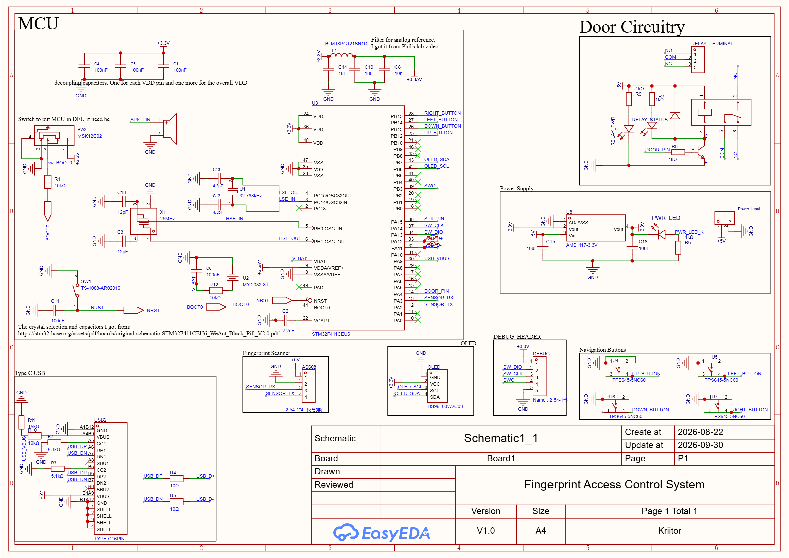

# STM32 Fingerprint Access Control System
A biometric fingerpint access control system for controlling electromagnetic door locks. 

## Features
- Can enroll up to 300 fingerprints
- Stores log of who has accessed the builidng
- The log uses a rolling memory i.e when it is full it starts overwriting from the top
- Firmware allows role assignment
- Only users with specific roles can enroll new users, delete existing users and view logs
- No companion app needed everything happens on device 
- Employs a dry contact for driving the electromagnetic door lock
- It has a real time clock which is used for logging the time a users accessed the building

---

## Table of Contents

1. [Project Description](#project-description)
2. [Hardware and Wiring](#hardware-and-wiring)
   - [Pin Mapping Table](#pin-mapping-table)
   - [Electrical Specifications and Component Circuitry](#electrical-specifications-and-component-circuitry)
   - [System Interconnect Diagram](#system-interconnect-diagram)
   - [Schematic Diagram](#schematic-diagram)
3. [User Manual](#user-manual)
   - [First-Boot Initialization and Master Setup](#first-boot-initialization-and-master-setup)
   - [Keypad Navigation and Universal Exit Rule](#keypad-navigation-and-universal-exit-rule)
   - [Main Menu Structure](#main-menu-structure)
   - [Access Control Mode](#access-control-mode)
   - [User Enrollment Mode](#user-enrollment-mode)
   - [User Deletion Mode](#user-deletion-mode)
   - [Audit Log Mode](#audit-log-mode)
   - [Set Time Mode](#set-time-mode)
4. [Features and Code Walkthrough](#features-and-code-walkthrough)
   - [1. Acoustic Audio Feedback Subsystem](#1-acoustic-audio-feedback-subsystem)
   - [2. Debounced Button Engine with Button Library](#2-debounced-button-engine-with-button-library)
   - [3. Flash EEPROM Memory Layout and Direct Offsets](#3-flash-eeprom-memory-layout-and-direct-offsets)
   - [4. Master Authorization Gate and Sole Master Protection](#4-master-authorization-gate-and-sole-master-protection)
   - [5. AS608 Biometric DSP State Machine](#5-as608-biometric-dsp-state-machine)
   - [6. Internal RTC Hardware Seeding and VBAT Battery Retention](#6-internal-rtc-hardware-seeding-and-vbat-battery-retention)
   - [7. EEPROM-Backed Circular Audit Logging System](#7-eeprom-backed-circular-audit-logging-system)
   - [8. Constrained OLED Text Input Editor](#8-constrained-oled-text-input-editor)
5. [Function Reference](#function-reference)
   - [Main Application Module (Fingerprint_Access_Control.ino)](#main-application-module-fingerprint_access_controlino)
   - [Audio Subsystem Module (audio.h / audio.cpp)](#audio-subsystem-module-audioh--audiocpp)
   - [Biometrics Module (biometrics.h / biometrics.cpp)](#biometrics-module-biometricsh--biometricscpp)
   - [Button Module (buttons.h / buttons.cpp)](#button-module-buttonsh--buttonscpp)
   - [User Management Module (users.h / users.cpp)](#user-management-module-usersh--userscpp)
   - [Audit Logging Module (logger.h / logger.cpp)](#audit-logging-module-loggerh--loggercpp)
   - [Real-Time Clock Module (myTime.h / myTime.cpp)](#real-time-clock-module-mytimeh--mytimecpp)
   - [Display Engine Module (display.h / display.cpp)](#display-engine-module-displayh--displaycpp)

---

## Project Description

The STM32 Fingerprint Access Control System delivers high-reliability standalone physical security management using optical fingerprint verification. Engineered for resource-constrained real-time embedded environments, the system manages biometric DSP matching, local flash EEPROM persistence, non-blocking audio alerts, hardware RTC timekeeping, and power-managed relay driving without requiring external clock ICs.

### Core Capabilities
* **Biometric DSP State Machine**: Operates an AS608 optical fingerprint sensor over hardware USART at 57,600 baud, executing two-pass image capture, feature vector extraction, fused template generation, and onboard DSP flash storage.
* **Transistor-Driven Relay Actuation**: Controls an onboard SRD 5V SPDT door lock relay (`K1`) via an NPN switching transistor (`Q1`) with flyback diode protection (`D1`) and dedicated dual LEDs for power (`RELAY_PWR`) and coil activation (`RELAY_STATUS`).
* **Hardware RTC with Battery Backup**: Leverages the internal STM32 hardware RTC peripheral driven by a 32.768 kHz LSE oscillator. Accepts coin cell backup power via `VBAT` to preserve accurate timekeeping across main supply power cycles.
* **Acoustic Audio Subsystem**: Drives a 2.7 kHz resonant piezo buzzer (`BUZZER1`) on pin `PA15` (`SPK_PIN`) to deliver distinct acoustic feedback for key presses, access verification, multi-stage enrollment, user deletion, startup, and warning alerts.
* **Debounced Keypad Processing**: Integrates the `Button` library across GPIO pins (`PB12`, `PB13`, `PB14`, `PB15`), providing debounced latching inputs with automatic acoustic click triggers.
* **Direct-Offset EEPROM Memory Engine**: Serializes user records (`UserRecord`) into internal Flash memory using an `0xA5` magic validation byte, allowing O(1) constant-time direct address index calculation.
* **Sole Master Protection & Privilege Gate**: Prevents administrative lockouts by requiring Master fingerprint authorization for sensitive modes (Enrollment, Deletion, Log Viewing, Time Setting) while blocking deletion of the system's final Master user.
* **Non-Volatile Audit Logging**: Maintains a 20-record circular access log buffer in flash EEPROM starting at address 3000, storing time-stamped entry records that persist across power cycles.

---

## Hardware and Wiring

### Pin Mapping Table

| Schematic Net Name | STM32 Pin | Interface / Mode | Hardware Subsystem & Description |
| :--- | :--- | :--- | :--- |
| `SENSOR_TX` | `PA2` | Hardware USART1 RX | Receives serial response packets from AS608 Optical DSP (57,600 Baud). |
| `SENSOR_RX` | `PA3` | Hardware USART1 TX | Sends serial command packets to AS608 Optical DSP (57,600 Baud). |
| `DOOR_PIN` | `PA4` | GPIO Output | Controls base of NPN transistor `Q1` to energize door lock relay `K1` (HIGH = Unlock). |
| `SPK_PIN` | `PA15` | GPIO / PWM Output | Drives 2.7 kHz piezo buzzer `BUZZER1` for acoustic feedback. |
| `OLED_SCL` | `PB6` | Hardware I2C1 SCL | Clock line for SSD1306 OLED display (400 kHz Fast-Mode). |
| `OLED_SDA` | `PB7` | Hardware I2C1 SDA | Data line for SSD1306 OLED display (I2C Address `0x3C`). |
| `UP_BUTTON` | `PB12` | GPIO Input | Tactile switch UP input (`Button` library, active LOW on press). |
| `DOWN_BUTTON` | `PB13` | GPIO Input | Tactile switch DOWN input (`Button` library, active LOW on press). |
| `LEFT_BUTTON` | `PB14` | GPIO Input | Tactile switch LEFT input (`Button` library, active LOW on press). |
| `RIGHT_BUTTON` | `PB15` | GPIO Input | Tactile switch RIGHT input (`Button` library, active LOW on press). |
| `V_BAT` | `VBAT` (Pin 1) | Power Input | Backup power line connected to CR2032 3V Lithium coin cell for RTC domain retention. |

### Electrical Specifications and Component Circuitry

#### 1. Power Supply and Linear Voltage Regulation
* **5V Primary Rail (`+5V`)**: Supplied via 16-pin Type-C USB connector (`USB2`) or KF301-2P 2-pin screw terminal block (`Power_Input`). Powers the AS608 optical sensor, SRD relay coil `K1`, and 3.3V voltage regulator `U8`.
* **3.3V Regulated Rail (`+3.3V`)**: Generated by SOT-223 3.3V linear regulator (`U8`). Supplies MCU VDD pins (`U3.24`, `U3.36`, `U3.48`), SSD1306 OLED display (`OLED.2`), SWD debug header (`DEBUG.1`), and pull-up lines. Indicated by Red Power LED (`PWR_LED`) via 1k resistor `R6`.

#### 2. Door Lock Relay Drive Circuitry
* **Relay Component (`K1`)**: SRD-series 5V SPDT electro-mechanical relay.
* **Transistor Driver (`Q1`)**: SOT-23 NPN switching transistor (`Q1`). MCU GPIO `PA4` (`DOOR_PIN`) drives transistor base via 1k resistor `R8`. Setting `PA4` HIGH saturates `Q1`, pulling relay coil pin to GND to energize relay.
* **Flyback Protection Diode (`D1`)**: SOD-323 diode connected across relay coil to suppress inductive voltage spikes during transistor turn-off.
* **Visual Status Indicators**:
  * `RELAY_PWR`: Red LED connected across 5V supply rail via 1k resistor `R9`.
  * `RELAY_STATUS`: Green LED connected in parallel with relay coil via 1k resistor `R7`, illuminating when relay is energized.
* **Output Terminal (`RELAY_TERMINAL`)**: KF301-3P 3-pin screw terminal providing Normally Open (`NO`), Common (`COM`), and Normally Closed (`NC`) dry contacts.

#### 3. Real-Time Clock Backup Battery Domain
* **Coin Cell Holder (`U2`)**: Accommodates a CR2032 3V Lithium coin cell.
* **Backup Filtering**: Connected to MCU `VBAT` (Pin 1) via 10k resistor `R12` and decoupling capacitor `C6` (100nF). Preserves internal RTC counter registers and clock state when primary +5V supply is disconnected.

#### 4. Audio Speaker Interface
* **Buzzer (`BUZZER1`)**: BD9.0 2.7 kHz resonant piezo transducer connected directly between MCU pin `PA15` (`SPK_PIN`) and GND.

#### 5. Input Switches
* **Navigation Keypad (`U4`, `U5`, `U6`, `U7`)**: 4 tactile pushbuttons connected to pins `PB12`, `PB14`, `PB13`, `PB15` respectively, grounded when pressed.
* **Reset Switch (`SW1`)**: Connected to MCU `NRST` (Pin 7) with 100nF filtering capacitor `C11`.
* **Boot Mode Switch (`SW2`)**: Slide switch connecting `BOOT0` (Pin 44) to +3.3V or GND via 1k resistor `R1`.

### System Interconnect Diagram

```text
                               +----------------------------------------+
                               |         STM32F411 / STM32F103 MCU      |
                               |              (UFQFPN-48 Package)       |
                               |                                        |
+------------------------+     |                                        |     +------------------------+
|   AS608 Optical DSP    |     |                                        |     |   SSD1306 OLED Display |
|                        |     |                                        |     |        (128 x 64)      |
|  TX (Pin 4) -----------+---->| PA2 (SENSOR_TX / USART1 RX)            |     |                        |
|  RX (Pin 3) <----------+-----| PA3 (SENSOR_RX / USART1 TX)            |     |                        |
|  VCC (+5V Rail)        |     |                         PB6 (OLED_SCL) |---->| SCL (Pin 3)            |
|  GND                   |     |                         PB7 (OLED_SDA) |---->| SDA (Pin 4)            |
+------------------------+     |                                        |     | VCC (+3.3V), GND       |
                               |                                        |     +------------------------+
+------------------------+     |                                        |
|  CR2032 Coin Cell (U2) |     |                                        |     +------------------------+
|  3V Battery Backup ----+---->| VBAT (Pin 1)            PA4 (DOOR_PIN) |---->|  NPN Transistor Q1     |
+------------------------+     |                                        |     |  (Drives Relay K1 Coil)|
                               |                                        |     +-----------┬------------+
+------------------------+     |                                        |                 │
|    4-Button Keypad     |     |                                        |                 ▼
|                        |     |                                        |     +------------------------+
|  UP Button (U4) -------+---->| PB12 (UP_BUTTON)                       |     | KF301-3P Relay Terminal|
|  DOWN Button (U6) -----+---->| PB13 (DOWN_BUTTON)                     |     | (NO, COM, NC Contacts) |
|  LEFT Button (U5) -----+---->| PB14 (LEFT_BUTTON)                     |     +------------------------+
|  RIGHT Button (U7) ----+---->| PB15 (RIGHT_BUTTON)                    |
|  GND                   |     |                        PA15 (SPK_PIN)  |---->| 2.7kHz Piezo BUZZER1   |
+------------------------+     |                                        |     +------------------------+
                               +----------------------------------------+
```

### Schematic Diagram


---

## User Manual

### First-Boot Initialization and Master Setup
1. **Cold Boot Sequence**: Upon applying power (via USB-C or KF301 power terminal), the MCU initializes GPIO pins, configures RTC clock sources, loads EEPROM indexes, initializes the audio subsystem (`audioInit` & `audioStartup()`), and verifies communication with the AS608 biometric sensor.
2. **Startup Audio Chime**: Emits an ascending 3-tone chime (`800 Hz -> 1200 Hz -> 1600 Hz`).
3. **Zero-User Condition**: If `getEnrolledCount()` detects 0 enrolled users:
   - System automatically enters **Enrollment Mode**.
   - User #1 is assigned ID `1` and granted **Master** status (`notMaster = 0`).
   - OLED prompts for a 4-character user name using the text editor widget.
   - User scans finger twice to store biometric template #1 in AS608 DSP Flash and EEPROM slot #1.
4. **Normal Operating Condition**: If users exist in EEPROM, system initializes directly into **Access Control Mode**.

### Keypad Navigation and Universal Exit Rule
The navigation keypad consists of 4 directional switches:
* **UP Button (`PB12`)**: Moves options upward, increments ASCII text characters, selects page 1 menu item. Emits `audioBeep()`.
* **DOWN Button (`PB13`)**: Moves options downward, decrements ASCII text characters, selects page 1 menu item. Emits `audioBeep()`.
* **LEFT Button (`PB14`)**: Confirms selections, acts as `<YES` or `<DEL` action confirmation. Emits `audioBeep()`.
* **RIGHT Button (`PB15`)**: **Universal Exit / Cancel Button**. Pressing RIGHT cancels active submodules, steps back through menus, exits prompt screens, and returns directly to the main menu. Emits `audioBeep()`.

### Main Menu Structure

```text
[ Access Mode ] ── (Press RIGHT to Exit) ──> [ Menu Page 1 ] ── (Press RIGHT) ──> [ Menu Page 2 ]
                                                  │                                   │
                                                  ├── UP: Enroll Mode                 ├── UP: Log Mode
                                                  ├── DOWN: Access Mode               └── DOWN: Set Time Mode
                                                  └── LEFT: Delete Mode
```

### Access Control Mode
* **Ready Screen**: Displays `"Place Finger"` with header `"Access Mode"`.
* **Verification Workflow**:
  1. User places finger on AS608 optical sensor window.
  2. Sensor captures print image and executes search query against onboard DSP template database.
  3. If match is verified:
     - Plays `audioAccessGranted()` ascending chime (`1046 Hz -> 1318 Hz -> 1568 Hz`).
     - OLED displays `"Welcome <NAME>"`.
     - Relay control pin `PA4` is set HIGH, turning ON transistor `Q1` and energizing relay `K1` for 4.0 seconds (Green `RELAY_STATUS` LED illuminates).
     - Pin `PA4` returns LOW to re-lock door.
     - Access entry log is recorded into flash EEPROM via `logAccess()`.
  4. If match fails:
     - Plays `audioAccessDenied()` low buzz (`300 Hz -> 220 Hz`).
     - OLED displays `"Invalid"` for 1.0 second and returns to ready state.

### User Enrollment Mode
* **Privilege Guard**: Requires a Master fingerprint scan before opening enrollment.
* **Enrollment Workflow**:
  1. System checks EEPROM capacity (`getNextAvailableID()`). If capacity (300 users) is reached, displays `"no space"`.
  2. Name Entry: User inputs a 4-character name using the text editor widget. Keypresses emit `audioBeep()`.
  3. Master Role Assignment: Displays `"Master??"` with options `<YES` (LEFT) or `NO>` (RIGHT).
  4. Biometric Capture:
     - Displays `"PLACE FINGER"`. Sensor captures image 1. Plays `audioEnrollStep()`.
     - Displays `"REMOVE FINGER"`. User lifts finger for 2 seconds.
     - Displays `"place finger"`. User places same finger again. Plays `audioEnrollStep()`.
     - Fuses template buffers (`createModel()`) and stores model to AS608 DSP Flash (`storeModel()`).
  5. Completion: Plays `audioEnrollSuccess()` ascending chime (`1000 Hz -> 1500 Hz -> 2000 Hz`). Writes `UserRecord` struct to EEPROM flash.
  6. Failure: Plays `audioEnrollError()` descending tone (`400 Hz -> 250 Hz`).
  7. Repeat Prompt: Displays `"Again??"` (`<YES` / `NO>`).

### User Deletion Mode
* **Privilege Guard**: Requires a Master fingerprint scan before opening delete mode.
* **Submenu Options**: Prompts `"Query Opt"` with options `U-Scroll` (UP) or `D-Name` (DOWN).
* **Option 1: Scroll Mode (`UP`)**:
  1. Displays user records sequentially: `"Del <NAME>"`.
  2. Scroll records with `UP` and `DOWN` buttons.
  3. Press `LEFT` (`<DEL`) to delete.
  4. **Sole Master Protection**: If target user is a Master (`notMaster == 0`) and `getMasterCount() <= 1`, deletion is blocked. Plays `audioWarning()` double chirp, displays `"Cant't Delete"`, and aborts.
  5. On successful check, plays `audioDelete()` descending tone (`600 Hz -> 400 Hz`), erases AS608 biometric template (`deleteFingerprint`), clears EEPROM slot (`deleteUser`), and refreshes index.
* **Option 2: Name Search Mode (`DOWN`)**:
  1. Prompts for 4-character target name using text editor widget.
  2. Searches EEPROM for matching string records.
  3. Evaluates Sole Master rule. Triggers `audioWarning()` if blocked.
  4. Erases matching biometric DSP templates and EEPROM records while playing `audioDelete()`. Displays `<NAME> deltd` or `Not Found`.

### Audit Log Mode
* **Privilege Guard**: Requires Master fingerprint scan before opening log mode.
* **Log Viewer Workflow**:
  1. Queries total stored log entries from EEPROM (`getLogCount()`). Displays `"No Logs"` if 0.
  2. Renders log record frame on OLED screen:
     - Line 1: `Log X/Y` (Record index out of total valid logs)
     - Line 2: `<NAME>`
     - Line 3: `DD/MM/YY HH:MM`
  3. Navigate log history chronologically using `UP` and `DOWN` buttons with `audioBeep()` sound feedback.
  4. Press `RIGHT` to return to menu.

### Set Time Mode
* **Privilege Guard**: Requires Master fingerprint scan before opening set time mode.
* **Interactive Clock Editor**:
  1. Displays current RTC time `[HH:MM]` and date `[DD/MM/20YY]`.
  2. Selection pointer (`^`) highlights active field (0: Hours, 1: Minutes, 2: Day, 3: Month, 4: Year).
  3. `RIGHT` Button: Cycles active field pointer (`Hours -> Minutes -> Day -> Month -> Year`) with `audioBeep()`.
  4. `UP` / `DOWN` Buttons: Increments or decrements selected parameter with auto-wrapping boundaries and `audioBeep()`.
  5. `LEFT` Button: Commits updated parameters directly into internal STM32 hardware RTC registers via `setManualDateTime()` and returns to main menu.

---

## Features and Code Walkthrough

### 1. Acoustic Audio Feedback Subsystem
The acoustic audio subsystem (`audio.h` / `audio.cpp`) manages tone frequency generation driving piezo transducer `BUZZER1` connected to MCU pin `PA15` (`SPK_PIN`).

```cpp
// audio.h
void audioInit(uint8_t pin = SPEAKER_PIN);
void playTone(uint16_t frequency, uint16_t durationMs);
void stopTone();

void audioBeep();
void audioAccessGranted();
void audioAccessDenied();
void audioEnrollStep();
void audioEnrollSuccess();
void audioEnrollError();
void audioStartup();
void audioDelete();
void audioWarning();
```

```cpp
// audio.cpp (Access Granted / Denied Excerpt)
void audioAccessGranted() {
  tone(audioPin, 1046, 100);
  delay(110);
  tone(audioPin, 1318, 100);
  delay(110);
  tone(audioPin, 1568, 180);
  delay(190);
  noTone(audioPin);
}

void audioAccessDenied() {
  tone(audioPin, 300, 150);
  delay(170);
  tone(audioPin, 220, 250);
  delay(260);
  noTone(audioPin);
}
```

#### Acoustic Tone Specifications
* **Key Click (`audioBeep`)**: 2400 Hz tone for 35 ms.
* **Access Granted (`audioAccessGranted`)**: Tri-tone chord: 1046 Hz -> 1318 Hz -> 1568 Hz.
* **Access Denied (`audioAccessDenied`)**: Low dual-tone buzz: 300 Hz -> 220 Hz.
* **Enroll Step (`audioEnrollStep`)**: High 1500 Hz chirp for 60 ms.
* **Enroll Success (`audioEnrollSuccess`)**: Ascending tri-tone chime: 1000 Hz -> 1500 Hz -> 2000 Hz.
* **Enroll Error (`audioEnrollError`)**: Descending low tone: 400 Hz -> 250 Hz.
* **Power-On Startup (`audioStartup`)**: Ascending chime: 800 Hz -> 1200 Hz -> 1600 Hz.
* **User Delete (`audioDelete`)**: Descending tone: 600 Hz -> 400 Hz.
* **Warning Alert (`audioWarning`)**: Double high-pitch chirp: 1800 Hz (80 ms interval).

---

### 2. Debounced Button Engine with Button Library
Button processing uses the `Button` library to manage software debouncing across directional pins (`PB12`, `PB13`, `PB14`, `PB15`).

```cpp
// buttons.h
#include <Button.h>

extern Button UP_BUTTON;
extern Button DOWN_BUTTON;
extern Button LEFT_BUTTON;
extern Button RIGHT_BUTTON;

void buttonConfig();
char* choice();
```

```cpp
// buttons.cpp
Button UP_BUTTON(PB12);
Button DOWN_BUTTON(PB13);
Button LEFT_BUTTON(PB14);
Button RIGHT_BUTTON(PB15);

void buttonConfig() {
  UP_BUTTON.begin();
  DOWN_BUTTON.begin();
  LEFT_BUTTON.begin();
  RIGHT_BUTTON.begin();
}

char* choice() {
  if (LEFT_BUTTON.pressed()) {
    audioBeep();
    return "yes";
  } else if (RIGHT_BUTTON.pressed()) {
    audioBeep();
    return "no";
  }
  return "";
}
```

---

### 3. Flash EEPROM Memory Layout and Direct Offsets
User records are persisted in STM32 internal flash memory using emulated EEPROM bytes. Direct hardware address offsets are calculated mathematically without full memory scans.

```cpp
// users.h
#define MAX_USERS 300

struct UserRecord {
  uint8_t magic;         // Validation byte (0xA5)
  uint16_t id;           // Unique user ID (1 to 300)
  char name[5];          // 4 characters + null terminator
  uint8_t notMaster;     // Role authorization: 0 = Master, 1 = Standard User
};
```

```cpp
// users.cpp
#define VALID_MAGIC 0xA5

int getEEPROMAddress(uint16_t userID) {
  return (userID - 1) * sizeof(UserRecord); // O(1) mathematical memory index calculation
}

bool userExist(uint16_t userID, UserRecord &user) {
  int addr = getEEPROMAddress(userID);
  EEPROM.get(addr, user);
  return (user.magic == VALID_MAGIC); // Flash byte default is 0xFF != 0xA5
}
```

#### Memory Layout
```text
EEPROM Memory Address Map:
+-------------------+--------------------+------------------------+
| Byte Range        | Contents           | Record Capacity        |
+-------------------+--------------------+------------------------+
| 0000 - 2999       | User Records       | Up to 300 User Records |
|                   | (UserRecord struct)| (10 bytes per struct)  |
+-------------------+--------------------+------------------------+
| 3000 - 3479       | Access Audit Logs  | Up to 20 Log Records   |
|                   | (LogRecord struct) | (24 bytes per struct)  |
+-------------------+--------------------+------------------------+
```

---

### 4. Master Authorization Gate and Sole Master Protection
Administrative submodules (Enrollment, Deletion, Log Viewing, Time Setting) require Master fingerprint authorization via `verifyMasterPermission()`. Deletion actions check `getMasterCount()`.

```cpp
// Fingerprint_Access_Control.ino
bool verifyMasterPermission(const char *modeHeader) {
  if (enrolledUsers == 0) {
    return true; // Bypass check on empty boot
  }
  display_three_words("Place", "Master", "Finger", 2);
  while (1) {
    if (exit()) return false;
    SensorRsp rsp = getFingerprintID();
    if (!rsp.isError) {
      uint16_t id = (uint16_t)strtol(rsp.msg, NULL, 10);
      UserRecord master = getUser(id);
      if (master.notMaster == 0) { // Verified Master user
        displayTwoWords("Master", master.name, modeHeader);
        delay(1000);
        return true;
      }
    }
  }
}
```

```cpp
// Deletion Guard Check in Delete Mode
if (user.notMaster == 0 && getMasterCount() <= 1) {
  debugln("Blocked deletion of sole Master user.");
  audioWarning();
  displayTwoWords("Cant't", "Delete", DeleteModeHeader);
  delay(1500);
  continue;
}
```

---

### 5. AS608 Biometric DSP State Machine
The AS608 biometric DSP module communicates over USART1 (`PA2`/`PA3`) at 57,600 baud. Enrollment executes a multi-pass pipeline to generate a fused model.

```cpp
// biometrics.cpp (Enrollment State Machine Excerpt)
uint8_t getFingerprintEnroll(uint8_t id) {
  // Pass 1: Capture initial fingerprint image
  while (finger.getImage() != FINGERPRINT_OK);
  audioEnrollStep();
  if (finger.image2Tz(1) != FINGERPRINT_OK) { audioEnrollError(); return FINGERPRINT_FEATUREFAIL; }

  // Wait for finger removal
  while (finger.getImage() != FINGERPRINT_NOFINGER);

  // Pass 2: Capture second fingerprint image
  while (finger.getImage() != FINGERPRINT_OK);
  audioEnrollStep();
  if (finger.image2Tz(2) != FINGERPRINT_OK) { audioEnrollError(); return FINGERPRINT_FEATUREFAIL; }

  // Model Fusion & DSP Flash Persistence
  if (finger.createModel() != FINGERPRINT_OK) { audioEnrollError(); return FINGERPRINT_ENROLLMISMATCH; }
  if (finger.storeModel(id) != FINGERPRINT_OK) { audioEnrollError(); return FINGERPRINT_FLASHERR; }

  audioEnrollSuccess();
  return FINGERPRINT_OK;
}
```

---

### 6. Internal RTC Hardware Seeding and VBAT Battery Retention
The internal STM32 hardware RTC peripheral is driven by a 32.768 kHz LSE oscillator (`U1`). On cold power-up, `timeConfig()` parses build preprocessor macros (`__TIME__`, `__DATE__`) to seed time parameters. When power is removed, the CR2032 coin cell connected to `VBAT` keeps the internal RTC counter running.

```cpp
// myTime.cpp
void timeConfig() {
#if defined(LSE_CLOCK)
  rtc.setClockSource(STM32RTC::LSE_CLOCK);
#elif defined(LSI_CLOCK)
  rtc.setClockSource(STM32RTC::LSI_CLOCK);
#endif
  rtc.begin();
  if (!rtc.isTimeSet()) {
    byte hours, minutes, seconds;
    sscanf(__TIME__, "%d:%d:%d", &hours, &minutes, &seconds);

    char monthStr[4];
    int day, year;
    sscanf(__DATE__, "%s %d %d", monthStr, &day, &year);

    const char *months[] = { "Jan", "Feb", "Mar", "Apr", "May", "Jun",
                             "Jul", "Aug", "Sep", "Oct", "Nov", "Dec" };
    int month = 1;
    for (int i = 0; i < 12; i++) {
      if (strcmp(monthStr, months[i]) == 0) { month = i + 1; break; }
    }
    rtc.setTime(hours, minutes, seconds);
    rtc.setDate(day, month, year % 100);
  }
}
```

---

### 7. EEPROM-Backed Circular Audit Logging System
Access entry records are saved into a 20-record circular log buffer in flash EEPROM starting at address 3000 (`MAX_USERS * sizeof(UserRecord)`).

```cpp
// logger.h
struct LogRecord {
  uint8_t magic;      // 0xA5 validation byte
  char name[5];       // 4-char user name + null
  char time[6];       // Format "HH:MM"
  char date[9];       // Format "DD/MM/YY"
};
```

```cpp
// logger.cpp
void logAccess(const char *name, bool granted) {
  LogRecord logRec;
  logRec.magic = LOG_MAGIC;
  strncpy(logRec.name, name, 4); logRec.name[4] = '\0';
  strncpy(logRec.time, getTime(), sizeof(logRec.time) - 1);
  strncpy(logRec.date, getDate(), sizeof(logRec.date) - 1);

  int addr = LOG_EEPROM_START_ADDR + (logHead * sizeof(LogRecord));
  EEPROM.put(addr, logRec);
  logHead = (logHead + 1) % MAX_LOGS; // Circular buffer index wrapping
}
```

---

### 8. Constrained OLED Text Input Editor
Users name enrolled fingerprints without a full keyboard using a 4-character cursor text input engine in `users.cpp`:

```cpp
// users.cpp
void getUserName(char (&name)[5]) {
  while (1) {
    displayTextInput(name, cursorPos);
    if (RIGHT_BUTTON.pressed()) {
      audioBeep();
      cursorPos = (cursorPos + 1) % 4; // Advance cursor position
    }
    if (UP_BUTTON.pressed()) {
      audioBeep();
      char c = name[cursorPos] + 1;
      if (c > 'Z') c = '@'; // ASCII upper bound wrapping
      name[cursorPos] = c;
    } else if (DOWN_BUTTON.pressed()) {
      audioBeep();
      char c = name[cursorPos] - 1;
      if (c < 'A') c = '@'; // ASCII lower bound wrapping
      name[cursorPos] = c;
    }
    if (LEFT_BUTTON.pressed()) {
      audioBeep();
      return; // Confirm and return name
    }
  }
}
```

---

## Function Reference

### Main Application Module (Fingerprint_Access_Control.ino)

#### `void setup()`
* **Signature**: `void setup()`
* **Parameters**: None
* **Return Value**: `void`
* **Description**: Initializes serial debugging (115200 baud), initializes audio hardware (`audioInit(SPEAKER_PIN)`), plays startup chime (`audioStartup()`), configures RTC timekeeping (`timeConfig`), button pins (`buttonConfig`), audit logger (`loggerInit`), and SSD1306 display (`checkDisplay`). Configures door relay pin (`PA4`) as output, locks door, initializes AS608 biometric sensor, counts existing users in EEPROM, and sets initial system mode to `"enroll"` (if zero users) or `"access"`.

#### `void loop()`
* **Signature**: `void loop()`
* **Parameters**: None
* **Return Value**: `void`
* **Description**: Executes the system Finite State Machine across modes: `"menu"`, `"enroll"`, `"access"`, `"delete"`, `"log"`, and `"settime"`. Evaluates input button events with acoustic `audioBeep()` triggers to transition states and invoke submodule routines.

#### `bool verifyMasterPermission(const char *modeHeader)`
* **Signature**: `bool verifyMasterPermission(const char *modeHeader)`
* **Parameters**:
  * `modeHeader`: `const char*` - String label displayed at top of OLED screen.
* **Return Value**: `bool` - Returns `true` if a registered Master fingerprint scan is verified; returns `false` if cancelled or unauthorized.
* **Description**: Displays Master authorization prompt on OLED screen. Polls AS608 biometric sensor until a scanned print matches a user record with `notMaster == 0`. Bypasses verification automatically if zero users exist (`enrolledUsers == 0`).

#### `bool exit()`
* **Signature**: `bool exit()`
* **Parameters**: None
* **Return Value**: `bool` - Returns `true` if RIGHT button was pressed (`RIGHT_BUTTON.pressed()`); `false` otherwise.
* **Description**: Universal exit helper function checking RIGHT navigation button status to trigger mode cancellation back to main menu.

#### `void lockDoor()`
* **Signature**: `void lockDoor()`
* **Parameters**: None
* **Return Value**: `void`
* **Description**: Sets GPIO pin `PA4` LOW, turning off transistor `Q1` and de-energizing door lock relay `K1`.

#### `void unlockDoor()`
* **Signature**: `void unlockDoor()`
* **Parameters**: None
* **Return Value**: `void`
* **Description**: Sets GPIO pin `PA4` HIGH, turning on transistor `Q1` and energizing door lock relay `K1`.

---

### Audio Subsystem Module (audio.h / audio.cpp)

#### `void audioInit(uint8_t pin)`
* **Signature**: `void audioInit(uint8_t pin = SPEAKER_PIN)`
* **Parameters**:
  * `pin`: `uint8_t` - Speaker output GPIO pin (default `PA15`).
* **Return Value**: `void`
* **Description**: Configures speaker pin mode as `OUTPUT`, sets pin LOW, and ensures tone generation is disabled (`noTone()`).

#### `void playTone(uint16_t frequency, uint16_t durationMs)`
* **Signature**: `void playTone(uint16_t frequency, uint16_t durationMs)`
* **Parameters**:
  * `frequency`: `uint16_t` - Tone frequency in Hz.
  * `durationMs`: `uint16_t` - Duration of tone in milliseconds.
* **Return Value**: `void`
* **Description**: Generates tone of specified frequency and duration on audio pin, delaying execution for specified duration before stopping tone.

#### `void stopTone()`
* **Signature**: `void stopTone()`
* **Parameters**: None
* **Return Value**: `void`
* **Description**: Disables tone generation and sets audio GPIO pin LOW.

#### `void audioBeep()`
* **Signature**: `void audioBeep()`
* **Parameters**: None
* **Return Value**: `void`
* **Description**: Plays short 2400 Hz keypress click tone for 35 ms.

#### `void audioAccessGranted()`
* **Signature**: `void audioAccessGranted()`
* **Parameters**: None
* **Return Value**: `void`
* **Description**: Plays ascending tri-tone chime sequence (1046 Hz -> 1318 Hz -> 1568 Hz) indicating authorized door unlock.

#### `void audioAccessDenied()`
* **Signature**: `void audioAccessDenied()`
* **Parameters**: None
* **Return Value**: `void`
* **Description**: Plays low-pitch descending buzz sequence (300 Hz -> 220 Hz) indicating unauthorized scan or match failure.

#### `void audioEnrollStep()`
* **Signature**: `void audioEnrollStep()`
* **Parameters**: None
* **Return Value**: `void`
* **Description**: Plays single high 1500 Hz chirp (60 ms) when fingerprint image capture step succeeds during enrollment.

#### `void audioEnrollSuccess()`
* **Signature**: `void audioEnrollSuccess()`
* **Parameters**: None
* **Return Value**: `void`
* **Description**: Plays ascending tri-tone success chime (1000 Hz -> 1500 Hz -> 2000 Hz) when user print is stored.

#### `void audioEnrollError()`
* **Signature**: `void audioEnrollError()`
* **Parameters**: None
* **Return Value**: `void`
* **Description**: Plays low-pitch error tone sequence (400 Hz -> 250 Hz) on enrollment imaging, matching, or storage failure.

#### `void audioStartup()`
* **Signature**: `void audioStartup()`
* **Parameters**: None
* **Return Value**: `void`
* **Description**: Plays ascending 3-note power-on chime sequence (800 Hz -> 1200 Hz -> 1600 Hz).

#### `void audioDelete()`
* **Signature**: `void audioDelete()`
* **Parameters**: None
* **Return Value**: `void`
* **Description**: Plays descending double-tone sequence (600 Hz -> 400 Hz) when a user record is deleted.

#### `void audioWarning()`
* **Signature**: `void audioWarning()`
* **Parameters**: None
* **Return Value**: `void`
* **Description**: Plays double high-pitch warning chirp (1800 Hz) when an action is blocked (such as Sole Master deletion).

---

### Biometrics Module (biometrics.h / biometrics.cpp)

#### `void biometricsSetup()`
* **Signature**: `void biometricsSetup()`
* **Parameters**: None
* **Return Value**: `void`
* **Description**: Initializes hardware serial connection (`mySerial`) at 57,600 baud for AS608 sensor interface. Enters persistent verification retry loop (`finger.verifyPassword()`) until sensor connection is confirmed. Prints sensor registers, status flags, capacity, security level, and packet lengths to serial debug output.

#### `uint8_t getFingerprintEnroll(uint8_t id)`
* **Signature**: `uint8_t getFingerprintEnroll(uint8_t id)`
* **Parameters**:
  * `id`: `uint8_t` - Target slot ID (1 to 300) to assign to enrolled print.
* **Return Value**: `uint8_t` - Returns `FINGERPRINT_OK` (0x00) on success; error code status byte otherwise.
* **Description**: Manages two-pass fingerprint image capture, template conversion (`image2Tz(1)` and `image2Tz(2)`), model fusion (`createModel()`), and commits generated template to AS608 internal DSP flash (`storeModel(id)`). Triggers `audioEnrollStep()`, `audioEnrollSuccess()`, or `audioEnrollError()` sound feedback and renders step-by-step progress guidance to OLED screen.

#### `SensorRsp getFingerprintID()`
* **Signature**: `SensorRsp getFingerprintID()`
* **Parameters**: None
* **Return Value**: `SensorRsp` - Structure containing message string pointer (`msg`) and error boolean flag (`isError`).
* **Description**: Captures single fingerprint image, converts image to feature vector (`image2Tz()`), and performs search query (`fingerSearch()`) against internal AS608 template database. If match is found, populates `msg` with ASCII user ID string and sets `isError = false`. Returns error status string and `isError = true` on failure or missing finger.

#### `bool deleteFingerprint(uint16_t id)`
* **Signature**: `bool deleteFingerprint(uint16_t id)`
* **Parameters**:
  * `id`: `uint16_t` - Fingerprint template ID to erase.
* **Return Value**: `bool` - Returns `true` if template was successfully removed from AS608 DSP flash; `false` on failure.
* **Description**: Issues `finger.deleteModel(id)` command packet to erase specified fingerprint template from AS608 internal flash memory.

#### `void deleteAllPrints()`
* **Signature**: `void deleteAllPrints()`
* **Parameters**: None
* **Return Value**: `void`
* **Description**: Issues `finger.emptyDatabase()` command packet to clear all stored biometric templates from AS608 DSP memory.

---

### Button Module (buttons.h / buttons.cpp)

#### `Button UP_BUTTON, DOWN_BUTTON, LEFT_BUTTON, RIGHT_BUTTON`
* **Signature**: `extern Button UP_BUTTON; extern Button DOWN_BUTTON; extern Button LEFT_BUTTON; extern Button RIGHT_BUTTON;`
* **Description**: Global `Button` object instances configured on pins `PB12` (UP), `PB13` (DOWN), `PB14` (LEFT), and `PB15` (RIGHT).

#### `void buttonConfig()`
* **Signature**: `void buttonConfig()`
* **Parameters**: None
* **Return Value**: `void`
* **Description**: Initializes 4 navigation button instances (`UP_BUTTON.begin()`, `DOWN_BUTTON.begin()`, `LEFT_BUTTON.begin()`, `RIGHT_BUTTON.begin()`), enabling software debouncing across keypad pins.

#### `char* choice()`
* **Signature**: `char* choice()`
* **Parameters**: None
* **Return Value**: `char*` - Returns `"yes"` if LEFT button was pressed, `"no"` if RIGHT button was pressed, or `""` if neither.
* **Description**: Helper function evaluating two-choice confirmation dialog inputs, triggering `audioBeep()` feedback on keypresses.

---

### User Management Module (users.h / users.cpp)

#### `int getEnrolledCount()`
* **Signature**: `int getEnrolledCount()`
* **Parameters**: None
* **Return Value**: `int` - Number of active enrolled user slots in EEPROM flash.
* **Description**: Iterates through user IDs (1 to 300), querying `userExist()`, counting total valid stored user records.

#### `bool userExist(uint16_t userID, UserRecord &user)`
* **Signature**: `bool userExist(uint16_t userID, UserRecord &user)`
* **Parameters**:
  * `userID`: `uint16_t` - Target user ID slot to query.
  * `user`: `UserRecord&` - Reference to record struct populated with slot contents.
* **Return Value**: `bool` - Returns `true` if slot contains `magic == 0xA5`; `false` if slot is unassigned/erased.
* **Description**: Computes EEPROM byte address using `getEEPROMAddress()`, reads `UserRecord` struct from flash EEPROM, and verifies magic validation byte.

#### `UserRecord getUser(uint16_t id)`
* **Signature**: `UserRecord getUser(uint16_t id)`
* **Parameters**:
  * `id`: `uint16_t` - Target user ID slot.
* **Return Value**: `UserRecord` - User record data struct read from EEPROM.
* **Description**: Reads and returns `UserRecord` from calculated EEPROM memory location.

#### `int getEEPROMAddress(uint16_t userID)`
* **Signature**: `int getEEPROMAddress(uint16_t userID)`
* **Parameters**:
  * `userID`: `uint16_t` - User ID (1 to 300).
* **Return Value**: `int` - Direct byte memory address in EEPROM flash.
* **Description**: Calculates address offset as `(userID - 1) * sizeof(UserRecord)`.

#### `void saveUser(UserRecord &user)`
* **Signature**: `void saveUser(UserRecord &user)`
* **Parameters**:
  * `user`: `UserRecord&` - Reference to user record struct to commit.
* **Return Value**: `void`
* **Description**: Sets `user.magic = 0xA5`, calculates address via `getEEPROMAddress()`, and writes record to EEPROM flash via `EEPROM.put()`.

#### `uint16_t getNextAvailableID()`
* **Signature**: `uint16_t getNextAvailableID()`
* **Parameters**: None
* **Return Value**: `uint16_t` - Lowest unused user ID slot (1 to 300); returns `0` if all slots full.
* **Description**: Scans EEPROM slots sequentially to find first slot where `userExist()` returns `false`.

#### `int getMasterCount()`
* **Signature**: `int getMasterCount()`
* **Parameters**: None
* **Return Value**: `int` - Number of active enrolled users with `notMaster == 0`.
* **Description**: Scans user records (1 to 300) and counts active users possessing Master privilege level.

#### `void deleteUser(UserRecord &user)`
* **Signature**: `void deleteUser(UserRecord &user)`
* **Parameters**:
  * `user`: `UserRecord&` - User record struct reference to invalidate.
* **Return Value**: `void`
* **Description**: Sets `user.magic = 0`, writes updated struct to EEPROM flash, decrements global `enrolledUsers` counter, and outputs debug log.

#### `void deleteAll()`
* **Signature**: `void deleteAll()`
* **Parameters**: None
* **Return Value**: `void`
* **Description**: Clears EEPROM memory slots by setting flash bytes to 0 across user storage area.

#### `void getUserName(char (&name)[5])`
* **Signature**: `void getUserName(char (&name)[5])`
* **Parameters**:
  * `name`: `char (&)[5]` - Reference to 5-byte array storing 4 characters + null terminator.
* **Return Value**: `void`
* **Description**: Runs interactive text input UI on OLED screen. Allows user to select character slots with RIGHT button, cycle ASCII characters (`@`, `A`-`Z`) with UP/DOWN buttons, and confirm string entry with LEFT button. Emits `audioBeep()` sound feedback on button presses.

---

### Audit Logging Module (logger.h / logger.cpp)

#### `void loggerInit()`
* **Signature**: `void loggerInit()`
* **Parameters**: None
* **Return Value**: `void`
* **Description**: Scans 20 log EEPROM slots starting at memory address 3000 (`MAX_USERS * sizeof(UserRecord)`), counting existing valid log entries (`magic == 0xA5`).

#### `void logAccess(const char *name, bool granted)`
* **Signature**: `void logAccess(const char *name, bool granted)`
* **Parameters**:
  * `name`: `const char*` - 4-character user name string.
  * `granted`: `bool` - Access result flag.
* **Return Value**: `void`
* **Description**: Constructs `LogRecord` struct, populates `magic = 0xA5`, copies `name`, current RTC time (`getTime()`), and current RTC date (`getDate()`). Writes record into EEPROM flash at circular head index (`logHead`), updating index (`logHead = (logHead + 1) % 20`).

#### `int getLogCount()`
* **Signature**: `int getLogCount()`
* **Parameters**: None
* **Return Value**: `int` - Total count of valid access log records stored in EEPROM.
* **Description**: Scans 20 log slots in EEPROM and returns count of valid slots containing `magic == 0xA5`.

#### `LogRecord getLog(int index)`
* **Signature**: `LogRecord getLog(int index)`
* **Parameters**:
  * `index`: `int` - Log history offset index (0 = newest log, `count-1` = oldest log).
* **Return Value**: `LogRecord` - Log record struct retrieved from EEPROM.
* **Description**: Scans EEPROM log slots, builds array of valid logs, and returns the Nth newest log record.

---

### Real-Time Clock Module (myTime.h / myTime.cpp)

#### `void timeConfig()`
* **Signature**: `void timeConfig()`
* **Parameters**: None
* **Return Value**: `void`
* **Description**: Configures RTC clock source (LSE oscillator if defined, or LSI fallback), initializes hardware RTC peripheral in 24-hour format, and checks if time is set. If unset, parses compiler macros `__TIME__` (`HH:MM:SS`) and `__DATE__` (`Mmm DD YYYY`) to seed internal hardware RTC registers automatically.

#### `char* getTime()`
* **Signature**: `char* getTime()`
* **Parameters**: None
* **Return Value**: `char*` - Pointer to static string buffer formatted as `"HH:MM"`.
* **Description**: Queries internal RTC hardware registers for hours and minutes, formatting output into static string buffer via `snprintf()`.

#### `char* getDate()`
* **Signature**: `char* getDate()`
* **Parameters**: None
* **Return Value**: `char*` - Pointer to static string buffer formatted as `"DD/MM/YY"`.
* **Description**: Queries internal RTC hardware registers for day, month, and year, formatting output into static string buffer via `snprintf()`.

#### `void setManualDateTime(uint8_t day, uint8_t month, uint8_t year, uint8_t hours, uint8_t minutes)`
* **Signature**: `void setManualDateTime(uint8_t day, uint8_t month, uint8_t year, uint8_t hours, uint8_t minutes)`
* **Parameters**:
  * `day`: `uint8_t` - Day of month (1 to 31).
  * `month`: `uint8_t` - Month of year (1 to 12).
  * `year`: `uint8_t` - 2-digit year (0 to 99).
  * `hours`: `uint8_t` - Hours (0 to 23).
  * `minutes`: `uint8_t` - Minutes (0 to 59).
* **Return Value**: `void`
* **Description**: Writes user-specified date and time values directly into STM32 hardware RTC registers.

---

### Display Engine Module (display.h / display.cpp)

#### `bool checkDisplay()`
* **Signature**: `bool checkDisplay()`
* **Parameters**: None
* **Return Value**: `bool` - Returns `true` if SSD1306 OLED initializes at address `0x3C`; `false` on failure.
* **Description**: Initializes SSD1306 OLED display driver (`display.begin(SSD1306_SWITCHCAPVCC, 0x3C)`).

#### `void displayWord(const char *word, const char *frameTitle, const char* optionR, const char* optionL)`
* **Signature**: `void displayWord(const char *word, const char *frameTitle, const char* optionR="", const char* optionL="")`
* **Parameters**:
  * `word`: `const char*` - Center text string to render.
  * `frameTitle`: `const char*` - Header text string.
  * `optionR`: `const char*` - Right button label text (optional).
  * `optionL`: `const char*` - Left button label text (optional).
* **Return Value**: `void`
* **Description**: Clears screen display buffer, draws header frame, renders centered word, draws option labels, and updates OLED display.

#### `void displayTwoWords(const char *word1, const char *word2, const char *frameTitle, const char* optionR, const char* optionL)`
* **Signature**: `void displayTwoWords(const char *word1, const char *word2, const char *frameTitle, const char* optionR="", const char* optionL="")`
* **Parameters**:
  * `word1`: `const char*` - First text line string.
  * `word2`: `const char*` - Second text line string.
  * `frameTitle`: `const char*` - Header title string.
  * `optionR`: `const char*` - Right option button label.
  * `optionL`: `const char*` - Left option button label.
* **Return Value**: `void`
* **Description**: Renders two centered text lines inside header frame with option labels.

#### `void displayTextInput(char *name, int8_t cursorPos)`
* **Signature**: `void displayTextInput(char *name, int8_t cursorPos)`
* **Parameters**:
  * `name`: `char*` - Pointer to 4-character text string array.
  * `cursorPos`: `int8_t` - Active cursor selection index (0 to 3).
* **Return Value**: `void`
* **Description**: Renders 4-character text string centered on OLED display with underline cursor rectangle beneath active position `cursorPos`.

#### `void displayOption(const char *text, const char* optionR, const char* optionL)`
* **Signature**: `void displayOption(const char *text, const char* optionR="NO>", const char* optionL="<YES")`
* **Parameters**:
  * `text`: `const char*` - Prompt question string.
  * `optionR`: `const char*` - Right option label (default `"NO>"`).
  * `optionL`: `const char*` - Left option label (default `"<YES"`).
* **Return Value**: `void`
* **Description**: Displays prompt question with dual choice navigation labels.

#### `void displayCustomMenu(const char *title, const char *option1, const char *option2)`
* **Signature**: `void displayCustomMenu(const char *title, const char *option1, const char *option2)`
* **Parameters**:
  * `title`: `const char*` - Submenu header title.
  * `option1`: `const char*` - First menu option string.
  * `option2`: `const char*` - Second menu option string.
* **Return Value**: `void`
* **Description**: Renders two-option submenu prompt screen on OLED.

#### `void displayMenu(uint8_t page)`
* **Signature**: `void displayMenu(uint8_t page = 1)`
* **Parameters**:
  * `page`: `uint8_t` - Active menu page index (1 or 2).
* **Return Value**: `void`
* **Description**: Renders 2-page system menu layout with navigation button guides (`U: Enroll`, `D: Access`, `L: Delete`, `R: Next>` on Page 1; `U: Log`, `D: Set Time`, `R: <Back` on Page 2).

#### `void display_three_words(const char* text1, const char* text2, const char* text3, int size)`
* **Signature**: `void display_three_words(const char* text1, const char* text2, const char* text3, int size)`
* **Parameters**:
  * `text1`: `const char*` - Line 1 text.
  * `text2`: `const char*` - Line 2 text.
  * `text3`: `const char*` - Line 3 text.
  * `size`: `int` - Font scale multiplier size.
* **Return Value**: `void`
* **Description**: Renders three stacked centered text lines on screen.

#### `void displayLogEntry(const char *name, const char *date, const char *time, int index, int total)`
* **Signature**: `void displayLogEntry(const char *name, const char *date, const char *time, int index, int total)`
* **Parameters**:
  * `name`: `const char*` - User name string in log entry.
  * `date`: `const char*` - Date timestamp string (`DD/MM/YY`).
  * `time`: `const char*` - Time timestamp string (`HH:MM`).
  * `index`: `int` - Active record index displayed.
  * `total`: `int` - Total records in log buffer.
* **Return Value**: `void`
* **Description**: Formats and renders single access log record entry frame on screen.

#### `void displayTimeInput(uint8_t day, uint8_t month, uint8_t year, uint8_t hours, uint8_t minutes, uint8_t fieldPos)`
* **Signature**: `void displayTimeInput(uint8_t day, uint8_t month, uint8_t year, uint8_t hours, uint8_t minutes, uint8_t fieldPos)`
* **Parameters**:
  * `day`: `uint8_t` - Day parameter value.
  * `month`: `uint8_t` - Month parameter value.
  * `year`: `uint8_t` - 2-digit year value.
  * `hours`: `uint8_t` - Hours parameter value.
  * `minutes`: `uint8_t` - Minutes parameter value.
  * `fieldPos`: `uint8_t` - Active editable cursor field index (0: Hours, 1: Minutes, 2: Day, 3: Month, 4: Year).
* **Return Value**: `void`
* **Description**: Formats interactive time setting GUI display on OLED screen, placing pointer indicator (`^`) under active editable field `fieldPos`.
